# System diagrams

All diagrams use Mermaid and represent the proposed target design. Update them alongside implementation changes.

## Context

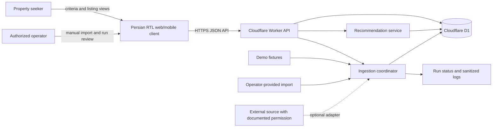

## Use case

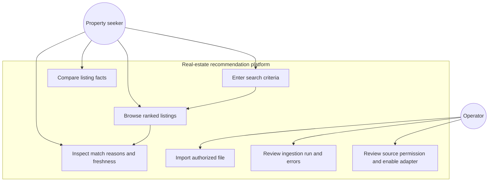

## Activity: search and recommendation

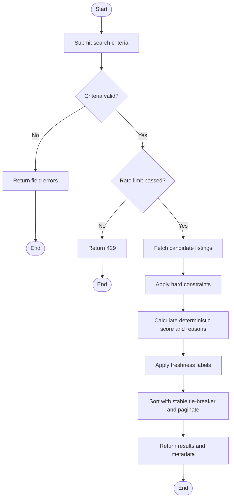

## Class/domain model

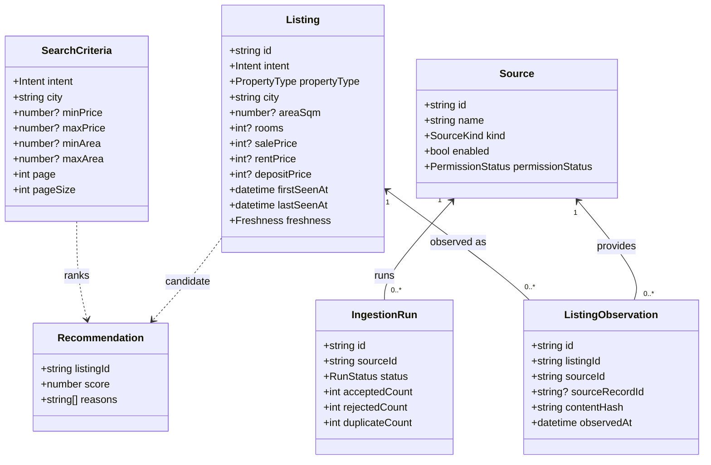

## Sequence: search

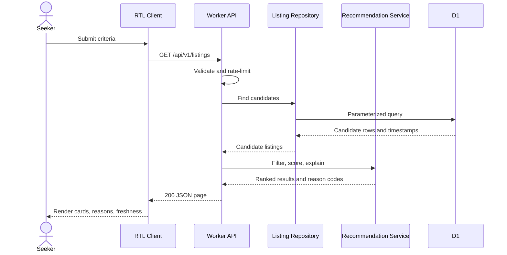

## State: listing lifecycle

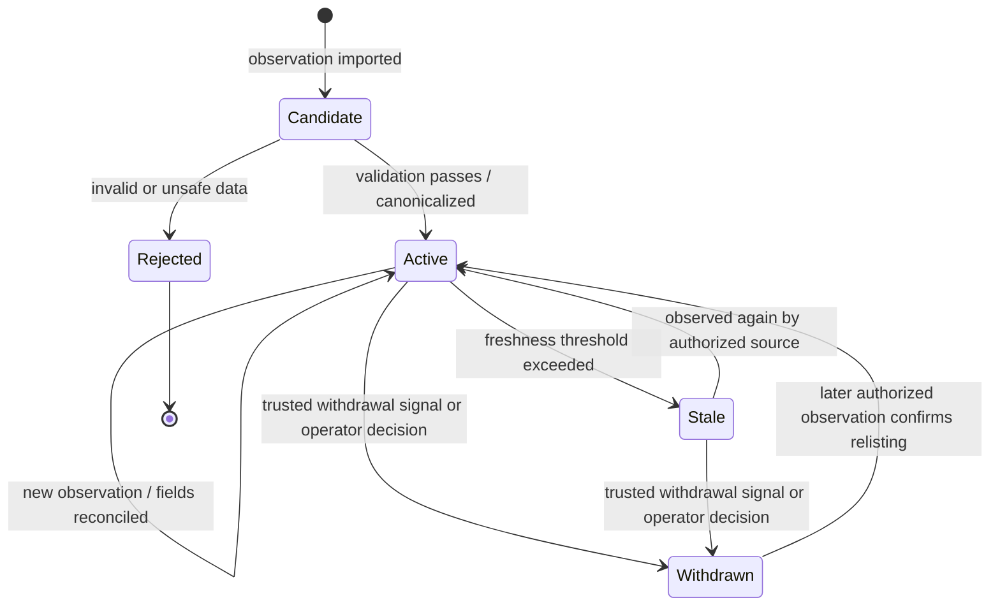

## Component architecture

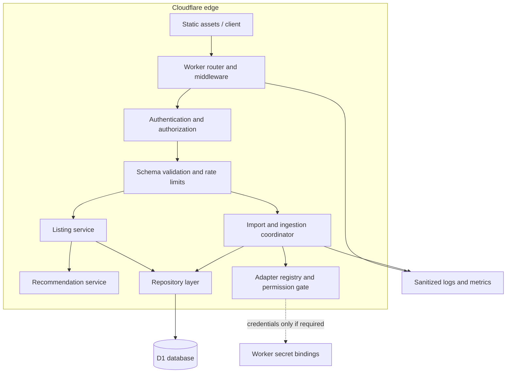

## Deployment

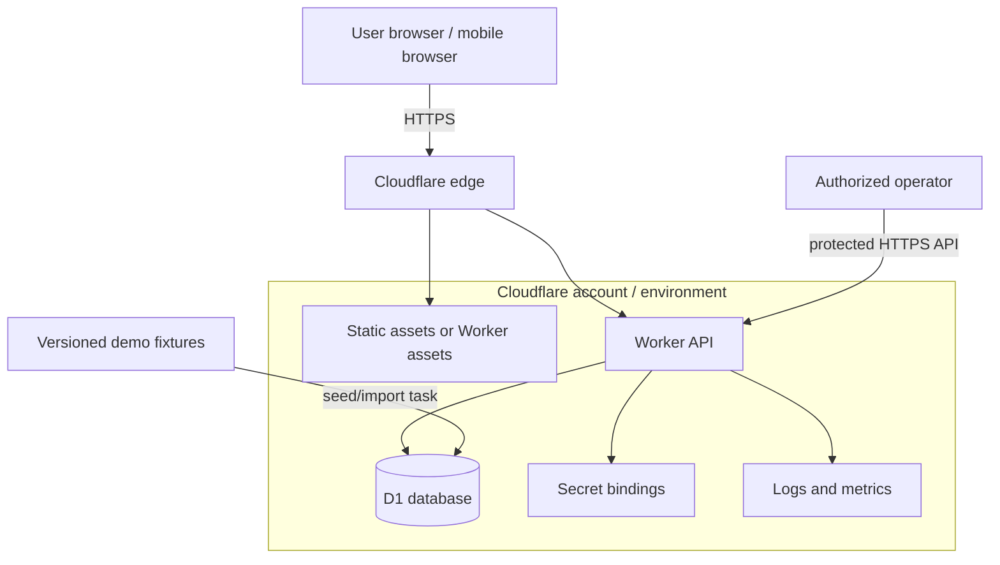

## ERD

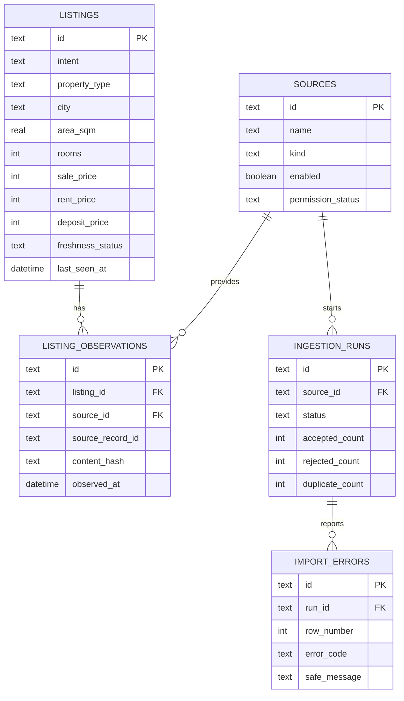

## Data flow

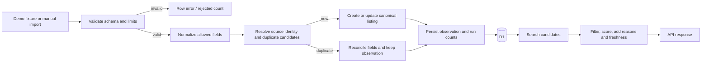

## Workflow: authorized ingestion

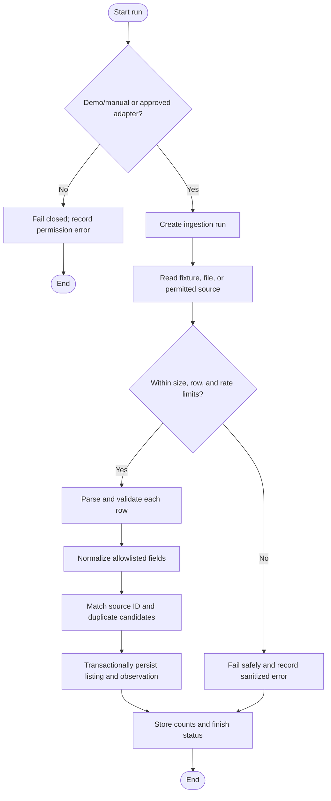

## Workflow: recommendation

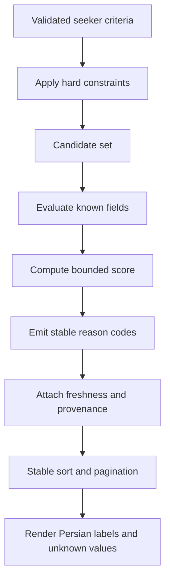
